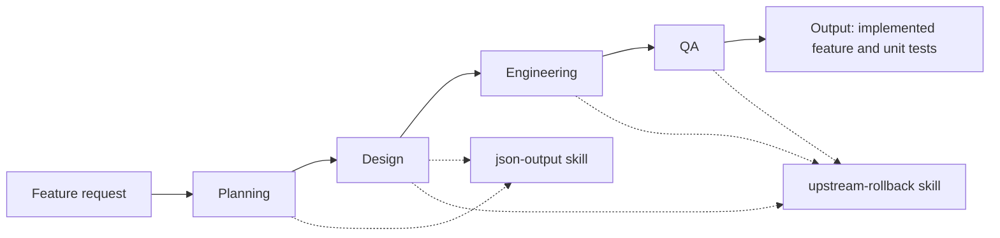

# AI SDLC agents

This project defines a block-based workflow for using AI agents to plan, design, implement, and test software features.

## Workflow



Each agent starts in a fresh, dedicated session and handles one feature block at a time. Planning must resolve every feature-related doubt with the user before writing or presenting a plan. Design resolves architecture and library decisions with the user before finalizing its block design.

## Agent responsibilities

| Agent | Responsibility | Skills |
| --- | --- | --- |
| Planning | Clarify requirements, inspect the codebase, split work into independent blocks when useful, and define acceptance criteria and test scenarios. | `json-output` |
| Design | Design the code changes for one planned block and resolve material architecture or dependency decisions with the user. | `json-output`, `upstream-rollback` |
| Engineering | Implement one approved block and run relevant lint, static analysis, and other code validations. | `upstream-rollback` |
| QA | Write and run unit tests for one developed block using its design and implementation. | `upstream-rollback` |

## Artifacts

Planning and Design save one JSON artifact per block:

```text
agents/features/<feature-name>/
├── plans/<feature-name>-<block-id>.plan.json
└── design/<feature-name>-<block-id>.design.json
```

When downstream work reveals a problem in requirements or design, record it and request a user decision before changing the source of truth:

```text
agents/<feature-name>/problems/<feature-name>.problem.json
```

The `json-output` skill defines the plan and design artifact formats. The `upstream-rollback` skill defines the problem log and decision process.

## Repository layout

```text
agents/
  planning.md
  design.md
  engineering.md
  qa.md
  workflow.mmd
skills/
  json-output/SKILL.md
  upstream-rollback/SKILL.md
```
